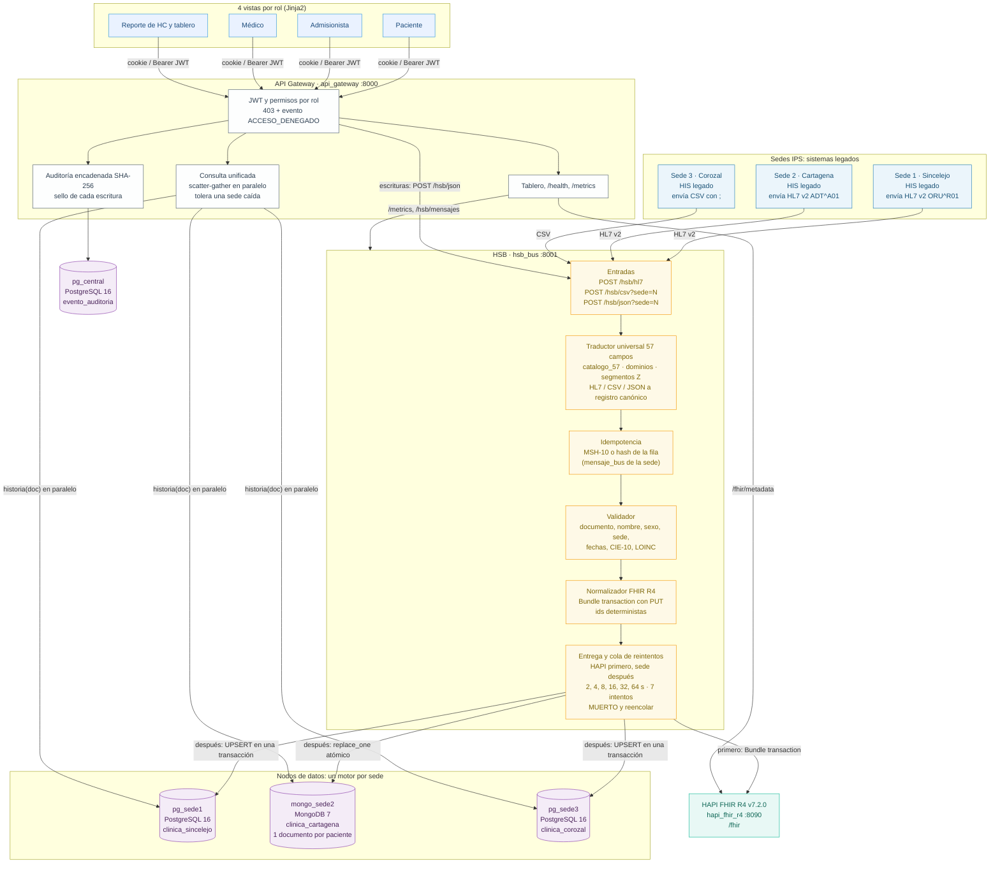

# Arquitectura del sistema y justificación de componentes

**Responsables:** A — Jose Guillermo Canchila (diagrama) · B — Sharit Javier Manjarrez (tabla de justificación, revisión v2)
**Versión:** v2 — motores heterogéneos por sede (PostgreSQL / MongoDB), traductor de 57 campos y auditoría en `pg_central`

---

## Diagrama de arquitectura

Todo se levanta con un comando: `docker compose down -v && docker compose up -d --build`
(7 contenedores). Los puertos son los de `.env.example`; si alguno está ocupado se cambia en `.env`.

**Regla de oro.** Ninguna vista habla directo con las bases de las sedes. Las lecturas pasan por
la consulta unificada de la API; las escrituras (admisión, diagnóstico, fórmula, egreso) se envían
al HSB por `/hsb/json` y siguen el mismo camino que un mensaje HL7.

| Contenedor | Imagen | Puerto en el anfitrión (variable de `.env`) |
|---|---|---|
| `pg_sede1` | `postgres:16-alpine` | 5433 (`DB_PORT_SEDE1`) |
| `mongo_sede2` | `mongo:7.0` | 27018 (`MONGO_PORT_SEDE2`) |
| `pg_sede3` | `postgres:16-alpine` | 5435 (`DB_PORT_SEDE3`) |
| `pg_central` | `postgres:16-alpine` | 5436 (`DB_PORT_CENTRAL`) |
| `hapi_fhir_r4` (servicio `hapi-fhir`) | `hapiproject/hapi:v7.2.0` | 8090 (`HAPI_PORT`) |
| `hsb_bus` (servicio `hsb`) | construida desde `hsb/Dockerfile` | 8001 (`HSB_PORT`) |
| `api_gateway` (servicio `api`) | construida desde `app/Dockerfile` | 8000 (`API_PORT`) |

Dentro de la red de Docker los servicios se hablan por nombre y puerto interno (`pg_sede1:5432`,
`mongo_sede2:27017`, `hapi-fhir:8080`, `hsb:8001`); los puertos del anfitrión solo sirven para
inspeccionar desde fuera.

---

## Tabla de justificación de componentes

> Cada componente responde a un requisito (RF1–RF6 o un RNF de la guía general). Nada por moda.

| Componente | Requisito que cubre | Alternativas consideradas | Por qué lo elegimos |
|---|---|---|---|
| **HSB propio (FastAPI)** | RF1, RF3 | Mirth Connect, Apache Camel, OpenHIM | Ambos integrantes pueden explicar y modificar cada paso en vivo (regla de la guía). El flujo traducir → idempotencia → validar → Bundle → entregar es corto y se prueba con `pytest`. Mirth y Camel resuelven el transporte HL7 pero agregan otra JVM y una curva de aprendizaje que no cabe en el parcial. Se sacrifican sus canales visuales. |
| **Traductor universal de 57 campos (`traductor/`)** | RF1, RF2, RF4 | Un mapeo escrito a mano por cada par formato → destino | Con 3 formatos de entrada (HL7, CSV, JSON) y 3 destinos (filas PostgreSQL, documento MongoDB, Bundle FHIR), pasar por un registro canónico exige 6 traducciones en lugar de 9, y todas leen el mismo catálogo. Agregar un campo es agregar una fila al catálogo. Cubre los 57 campos de la Res. 866 de 2021, incluidos los que HL7 v2.5 no trae (segmentos Z). |
| **HAPI FHIR R4 v7.2.0** | RF2 | Servidor FHIR comercial, implementar validación propia | Es la implementación abierta de referencia usada en el laboratorio; tiene imagen Docker oficial, acepta Bundles `transaction` y ofrece `$validate`. |
| **Sede 1 y Sede 3 en PostgreSQL 16** | RF4 | Citus, un solo PostgreSQL compartido | Un nodo por sede reproduce la red real: cada IPS conserva su base. Transacciones ACID locales: usuario, atención, diagnósticos, tecnologías y egreso se guardan juntos o no se guardan. |
| **Sede 2 en MongoDB 7** | RF4 (sedes heterogéneas, indicación del docente) | Tercer PostgreSQL | El escenario dice que cada sede conserva su sistema legado: no todos usan el mismo motor. MongoDB obliga a que la plataforma no dependa de un esquema único: el mismo dato vive con otros nombres (`identificacion.numero` en vez de `documento_id`) y otra forma (un documento por paciente con las atenciones embebidas). La atención completa se guarda en una sola escritura de un documento, que MongoDB hace atómica sin transacciones multi-documento. |
| **Repositorio con interfaz única (`db/repositorio.py`)** | RF3, RF4 | Código del bus con `if motor == ...` | El bus, la consulta unificada y el tablero piden `obtener_repositorio(sede)` y reciben `RepositorioPostgres` o `RepositorioMongo` con los mismos métodos. |
| **Consulta unificada en paralelo (`db/consulta_unificada.py`)** | RF4, RNF de tolerancia a fallos | Consulta secuencial, réplica central | `ThreadPoolExecutor` consulta las 3 sedes a la vez: una sede caída cuesta su timeout (3 s), no se suma a las otras. Responde con las sedes disponibles, marca `reporte_completo = false` y detecta datos distintos del mismo documento entre sedes. |
| **Estado del mensaje en `mensaje_bus` de cada sede** | RF3 | Redis con TTL, memoria del proceso | La idempotencia y la cola sobreviven a un reinicio del bus; el TTL de Redis podría expirar y dejar pasar un reenvío como nuevo. |
| **Cola de reintentos con hilo en segundo plano** | RF3, RNF | RabbitMQ, Kafka | Responde `202 reintentando` sin bloquear la petición y reintenta con espera creciente hasta 7 intentos (~2 min). Un broker sería otro servicio más que levantar y explicar; queda como propuesta para 100× más mensajes. |
| **API Gateway (FastAPI + Jinja2)** | RF5, RF6, RNF | SPA en React/Angular | Las vistas se sirven desde el mismo servicio, sin `node_modules` ni proceso de construcción aparte; los permisos se validan en la API y no solo en la pantalla. |
| **JWT HS256 con 4 roles** | RF5 | Keycloak (OIDC) | Cumple token + roles con lo mínimo. Keycloak se evaluó en el laboratorio pero suma un contenedor pesado y un flujo OIDC que no se demuestra en 15 min; queda como trabajo futuro. |
| **`pg_central` (auditoría)** | RF5 | Guardar la auditoría en una de las sedes, en memoria, Hyperledger Fabric | Separarla de las sedes permite apagar cualquier sede en la demo sin perder la trazabilidad, y da una tabla real (`evento_auditoria`) que el docente puede alterar con `UPDATE` para probar el verificador. Fabric queda como bonus no implementado. |
| **Cadena SHA-256 con `pg_advisory_xact_lock`** | RF5 | Firma por evento sin encadenar | Encadenar detecta alteración, borrado y reordenamiento; el candado evita que dos peticiones simultáneas enlacen al mismo hash anterior. |
| **`/health` y `/metrics` en HSB y API** | RNF | Prometheus + Grafana | Es el mínimo exigido; el tablero lee esos endpoints. Prometheus/Grafana queda como bonus no implementado. |

---

## Principio de diseño: sin microservicios por moda

Son 7 contenedores: 3 sedes, 1 base central de auditoría, HAPI, HSB y API. Cada uno existe porque:

1. Tiene un trabajo distinto (sede ≠ auditoría ≠ FHIR ≠ ingesta ≠ consulta).
2. Puede caer sin detener a los demás (se prueba apagando `mongo_sede2` o `hapi-fhir`).
3. Escala de forma distinta (el HSB necesitaría réplicas antes que las bases).

El traductor, el validador y el normalizador son módulos de Python dentro del HSB y de la API, no
servicios aparte.
