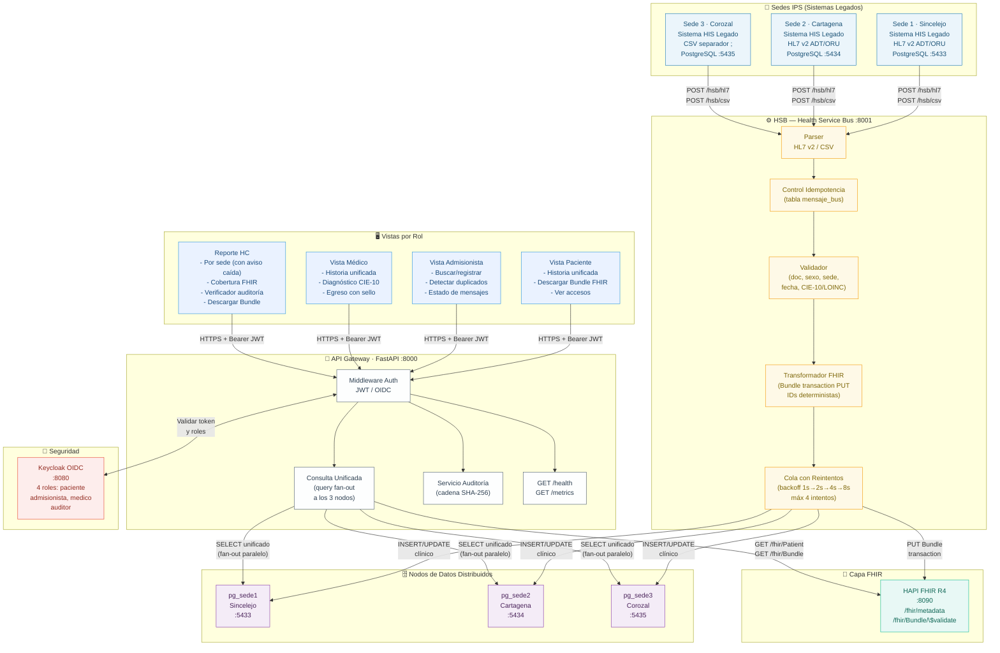

# Arquitectura del Sistema y Justificación de Componentes

**Responsable:** A — Jose Guillermo Canchila (diagrama) + B — Sharit Manjarrez (tabla de justificación)

---

## Diagrama de Arquitectura

---

## Tabla de Justificación de Componentes

> **Regla de oro:** cada componente responde a al menos un RF o RNF. Nada por moda.

| Componente | RF / RNF que cubre | Alternativas consideradas | Por qué esta elección |
|-----------|-------------------|--------------------------|----------------------|
| **HSB (FastAPI + cola propia)** | RF1, RF3 | Mirth Connect, Apache Camel, MuleSoft | Mirth tiene excelente soporte HL7 pero requiere instalación Java separada y GUI; Camel tiene curva de aprendizaje alta para un equipo de 2 personas. FastAPI es conocido del equipo (repo de referencia), permite pruebas unitarias directas con `pytest` y la cola propia con PostgreSQL como backend cumple el requisito de reintentos persistentes sin infraestructura adicional. Se sacrifica el soporte nativo de canales visuales de Mirth. |
| **HAPI FHIR R4** | RF2 | SMILE CDR, Microsoft FHIR Server, IBM FHIR Server | HAPI es la implementación de referencia open-source de FHIR R4; tiene imagen Docker oficial, endpoint `/fhir/Bundle/$validate` para validación, y es la herramienta usada en el laboratorio. SMILE CDR es comercial; Microsoft FHIR Server requiere Azure. |
| **3 nodos PostgreSQL (1 por sede)** | RF4, RNF (aislamiento) | Citus (sharding), MongoDB, un solo Postgres | Un nodo por sede replica la arquitectura real de la IPS (cada sede tiene su BD propia). Citus requeriría un nodo coordinador adicional y complica el `docker compose down -v`. La fragmentación horizontal por sede es natural: los datos de Cartagena están en pg_sede2, respetando la soberanía de los datos. Se sacrifica la consulta nativa unificada (se compensa con fan-out en la API). |
| **API Gateway (FastAPI)** | RF4, RF5, RF6, RNF | Django, Flask, Spring Boot | FastAPI ya está en el repo de referencia; proporciona tipado automático, OpenAPI generado y middleware de JWT sencillo. No se agrega tecnología nueva sin necesidad. |
| **Control de Idempotencia (tabla mensaje_bus)** | RF3 | Redis con TTL, caché en memoria | La persistencia en PostgreSQL garantiza que si el HSB cae y se reinicia, el estado de idempotencia no se pierde. Redis con TTL podría expirar y permitir un reenvío real que se trate como nuevo. |
| **Cola de reintentos (en BD, no RabbitMQ/Kafka)** | RF3, RNF | RabbitMQ, Kafka, Redis Streams | Kafka/RabbitMQ son infraestructura adicional que sube el `docker compose up` a >7 servicios. Con backoff exponencial sobre PostgreSQL se cumple el requisito de reintentos persistentes. Para 3 sedes y un equipo de 2 personas, esta solución es mantenible y demostrable. Se escalaría a Kafka con 100× más mensajes (anotado en viabilidad técnica). |
| **Keycloak OIDC (o JWT simple)** | RF5 | Auth0, Azure AD, JWT propio sin OIDC | Keycloak es open-source, corre en Docker, emite tokens OIDC/JWT estándar y soporta definición de roles y políticas. La alternativa JWT propio sin OIDC simplifica pero no soporta flujos OAuth2 completos que necesita el auditor externo. Se implementará Keycloak en Fase 4; en Fase 2-3 se usa JWT firmado con HS256 como placeholder. |
| **Auditoría encadenada (SHA-256)** | RF5 | Hyperledger Fabric, base de datos inmutable | SHA-256 enlazado (hash_propio = SHA256(hash_anterior + contenido)) es suficiente para detectar alteración sin la complejidad operacional de Fabric. Fabric queda como bonus (+0,25). |
| **4 vistas por rol (HTML/FastAPI Jinja2)** | RF6, RNF (accesibilidad) | React SPA, Angular | Jinja2 con FastAPI permite un frontend sin node_modules ni proceso de build separado; facilita el `docker compose up` limpio. Las vistas son server-side-rendered con contraste WCAG y etiquetas ARIA. |
| **`/health` y `/metrics` en cada servicio** | RNF | Prometheus + Grafana separado | El endpoint `/health` propio es el mínimo exigido. Se añade `/metrics` compatible con Prometheus para el bonus opcional sin que sea obligatorio para pasar la fase. |

---

## Principio de diseño: sin microservicios por moda

La arquitectura tiene **5 servicios en Docker** (3 BD + HAPI + HSB + API). No se crean microservicios adicionales para funciones que pueden vivir dentro del HSB o la API. Cada servicio existe porque:

1. Tiene un proceso de negocio diferente (ingesta ≠ consulta ≠ FHIR).
2. Puede caer de forma independiente sin parar todo el sistema.
3. Tiene requisitos de escalado diferentes (el HSB puede necesitar réplicas; los nodos de BD no).

