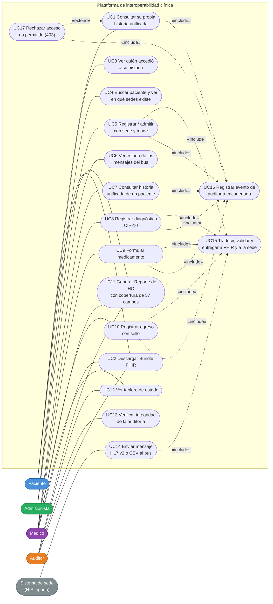

# Diagrama 1 · Casos de uso

**Responsables:** A — Jose Guillermo Canchila (diagrama) · B — Sharit Javier Manjarrez (revisión v2)
**Herramienta:** Mermaid (se renderiza en GitHub sin plugins)
**Versión:** v2 — sedes con motores distintos (PostgreSQL / MongoDB) y traductor de 57 campos

Mermaid no tiene un tipo de diagrama de casos de uso; se dibuja con `flowchart`: los actores son
los nodos de la izquierda, los casos de uso los óvalos dentro del límite del sistema y las flechas
punteadas son relaciones «include» / «extend».

## Actores

| Actor | Quién es | Cómo entra al sistema |
|---|---|---|
| **Paciente** | Persona atendida (`paciente_carlos`, doc. 1001) | Vistas web en `:8000` con JWT |
| **Admisionista** | Admisión y triage (`admision_laura`) | Vistas web en `:8000` con JWT |
| **Médico** | Profesional de salud (`medico_mateo`) | Vistas web en `:8000` con JWT |
| **Auditor** | Control y trazabilidad (`auditor_elena`) | Vistas web en `:8000` con JWT |
| **Sistema de sede** | Sistema legado de cada IPS (HIS de Sincelejo, Cartagena o Corozal) | HSB en `:8001` (`/hsb/hl7`, `/hsb/csv`) |

## Diagrama

## Descripción de los casos de uso

| UC | Caso de uso | Actor(es) | Dónde está en el código |
|---|---|---|---|
| UC1 | Consultar su propia historia unificada (3 sedes, ordenada por fecha, con la sede de cada atención) | Paciente | `GET /paciente` → `consultar_historia_unificada()` |
| UC2 | Descargar el Bundle FHIR R4 de la historia unificada | Paciente (solo el suyo), Médico, Auditor | `GET /api/pacientes/{doc}/bundle` |
| UC3 | Ver quién accedió a su historia y cuándo | Paciente | `obtener_ultimos_eventos(documento=...)` en `/paciente` |
| UC4 | Buscar por documento: en qué sedes existe y si hay datos distintos entre sedes (posible duplicado mal digitado) | Admisionista | `GET /admision?buscar_doc=` (sin diagnósticos) |
| UC5 | Registrar o admitir al paciente con sede y triage | Admisionista | `POST /admision/registrar` → HSB `/hsb/json` |
| UC6 | Ver el estado de los mensajes enviados al bus | Admisionista | HSB `GET /hsb/mensajes` (a través de la API) |
| UC7 | Consultar la historia unificada de cualquier paciente | Médico | `GET /medico?buscar_doc=` |
| UC8 | Registrar diagnóstico CIE-10 (ingreso, egreso o relacionado) | Médico | `POST /medico/diagnostico` |
| UC9 | Formular medicamento (campos 25 a 32) | Médico | `POST /medico/formula` |
| UC10 | Registrar el egreso (campos 40 a 50) con sello | Médico | `POST /medico/egreso` |
| UC11 | Generar el Reporte de HC por sede, con aviso de sede caída, cobertura de 57 campos y sello SHA-256 | Médico, Auditor, Paciente (solo el suyo) | `GET /reporte` |
| UC12 | Ver el tablero: nodos y su motor, cobertura FHIR por sede, métricas del bus, verificación de auditoría | Médico, Auditor | `GET /reporte?pestana=tablero` |
| UC13 | Verificar la cadena de auditoría y ver el primer evento alterado | Auditor (también Médico por API) | `GET /api/auditoria/verificar` |
| UC14 | Enviar un mensaje HL7 v2 (ADT^A01, ADT^A03, ORU^R01) o un CSV legado | Sistema de sede | `POST /hsb/hl7`, `POST /hsb/csv?sede=N` |
| UC15 | Traducir al registro canónico, verificar idempotencia, validar, publicar en HAPI y guardar en la sede (PostgreSQL o MongoDB) | — (lo ejecuta el HSB) | `hsb/ingesta.py`, `hsb/queue_manager.py` |
| UC16 | Registrar un evento en la cadena de auditoría SHA-256 (`pg_central`) | — (lo ejecuta la API) | `app/audit.py` |
| UC17 | Rechazar con 403 una acción que el rol no tiene permitida y dejarla auditada | — (lo ejecuta la API) | `app/rbac.py` |

## Coherencia con los otros diagramas

| Caso de uso | Participantes en la secuencia (diagrama 2) | Clases (diagrama 3) | Estados (diagrama 4) |
|---|---|---|---|
| UC14 / UC15 | Sistema de sede, HSB, Traductor, mensaje_bus, Validador, Normalizador, HAPI, Repositorio de la sede, Cola | `Sede`, `MensajeBus`, `RegistroCanonico`, `Campo`, `RepositorioSede` | RECIBIDO → … → ENTREGADO / RECHAZADO / REINTENTANDO / MUERTO |
| UC5, UC8, UC9, UC10 | API Gateway, Auditoría y luego el mismo flujo del HSB (entrada `/hsb/json`) | `Usuario`, `Atencion`, `Diagnostico`, `TecnologiaSalud`, `Egreso`, `EventoAuditoria` | Mismo ciclo de vida |
| UC7, UC11 | Médico, API Gateway, Repositorio de la sede (3 sedes en paralelo), Auditoría | `RepositorioPostgres`, `RepositorioMongo`, `EventoAuditoria` | — |
| UC13, UC16, UC17 | Auditoría | `EventoAuditoria` | — |

> **Mínimo privilegio.** UC5 (admisionista) y UC8 (médico) están separados a propósito. El
> admisionista no ve diagnósticos (la búsqueda de admisión devuelve solo identificación y datos de
> las atenciones sin contenido clínico) y no puede llamar `/medico/*` (403). El campo 31 (personal
> de salud) y el 50 (responsable del egreso) se toman del token, no del formulario: el médico no
> puede registrar a nombre de otro.
