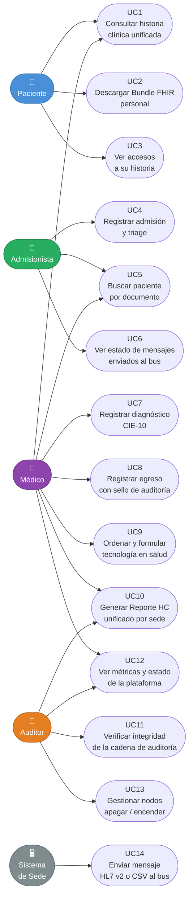

# Diagrama 1 · Casos de Uso

**Responsable:** A — Jose Guillermo Canchila
**Herramienta:** Mermaid (renderiza en GitHub/GitLab sin plugins)

## Actores

| Actor | Descripción |
|-------|-------------|
| **Paciente** | Persona atendida; solo puede ver su propia historia |
| **Admisionista** | Personal de admisión y triage; abre atenciones, NO ve diagnósticos |
| **Médico** | Profesional de salud; consulta, diagnostica y da egreso |
| **Auditor** | Perfil de control; verifica integridad y gestiona nodos |
| **SistemaSede** | Sistema legado de cada IPS; emite HL7 v2 y CSV al bus |

## Diagrama

## Coherencia con otros diagramas

| Caso de uso | Actor(es) | Clase(s) involucradas | Estado del mensaje |
|-------------|-----------|----------------------|-------------------|
| UC14 · Enviar HL7/CSV | SistemaSede | `MensajeBus`, `Sede` | RECIBIDO → VALIDADO/RECHAZADO |
| UC7 · Registrar diagnóstico | Médico | `Diagnostico`, `Atencion`, `Usuario` | — (escritura directa en BD) |
| UC11 · Verificar auditoría | Auditor | `EventoAuditoria` | — |
| UC10 · Reporte HC | Médico, Auditor, Paciente | Todos los recursos FHIR | ENTREGADO |

> **Nota de diseño:** UC4 (admisionista) y UC7 (médico) están separados deliberadamente.
> Un admisionista NO puede registrar diagnósticos (Regla RF6 y principio de mínimo privilegio).

