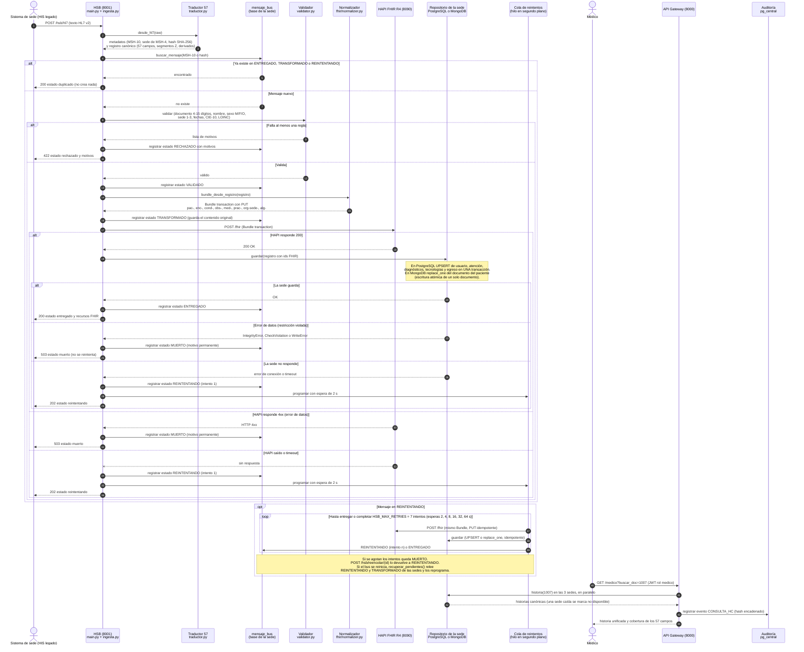

# Diagrama 2 · Secuencia — mensaje HL7 de una sede hasta FHIR, la base de la sede y la auditoría

**Responsables:** A — Jose Guillermo Canchila (diagrama) · B — Sharit Javier Manjarrez (revisión v2)
**Herramienta:** Mermaid `sequenceDiagram`
**Versión:** v2 — traductor universal, sede en PostgreSQL o MongoDB, reintentos en segundo plano

## Qué muestra

El recorrido de un mensaje HL7 v2 (por ejemplo `ejemplos/01_adt_a01_valido_sede2.hl7`) desde que
el sistema legado de la sede lo envía al HSB hasta que queda:

1. publicado en **HAPI FHIR R4** como Bundle `transaction` con `PUT` e ids deterministas, y
2. guardado en la **base de su sede** por el repositorio que corresponde a su motor:
   `RepositorioPostgres` (sedes 1 y 3) o `RepositorioMongo` (sede 2).

Incluye los caminos de **duplicado**, **rechazo** (error de validación), **reintento** (HAPI o la
sede no responden) y **error de datos** (va directo a MUERTO, sin reintentar).

**Sobre la auditoría.** Hay dos registros distintos y el diagrama muestra los dos:

- El **estado del mensaje** (RECHAZADO, VALIDADO, TRANSFORMADO, ENTREGADO, REINTENTANDO, MUERTO) se
  guarda en `mensaje_bus` (tabla en PostgreSQL / colección `mensajes_bus` en MongoDB) de la sede del
  mensaje. Es la trazabilidad del bus; de ahí salen la idempotencia y la recuperación tras reinicio.
- La **cadena de auditoría SHA-256** (`pg_central.evento_auditoria`) la escribe la API Gateway: cada
  consulta de una historia, cada escritura desde una vista y cada acceso denegado. El HSB no escribe
  en ella. Por eso la secuencia termina con la consulta del médico, que deja su evento encadenado.

## Diagrama

## Escritura desde una vista (misma ruta, otra entrada)

Las vistas no hablan con las bases. Cuando el médico registra un diagnóstico, una fórmula o un
egreso, la API **primero** registra el evento `ESCRITURA_HC` en `pg_central`; el hash de ese evento
es el **sello** que se devuelve al médico (y, en el egreso, se guarda en `egreso.sello_hash`).
Después envía el registro al HSB por `POST /hsb/json?sede=N`, que sigue los mismos pasos del
diagrama desde el traductor (`desde_json`). Si el HSB lo rechaza, la API agrega otro evento
`ESCRITURA_HC` con resultado `FALLIDO`. El admisionista sigue el mismo camino con el evento
`APERTURA_ATENCION`.

## Coherencia con los otros diagramas

| Participante | Caso de uso (diagrama 1) | Clase (diagrama 3) | Estados que produce (diagrama 4) |
|---|---|---|---|
| Sistema de sede | UC14 | `Sede` | RECIBIDO |
| Traductor 57 | UC15 | `RegistroCanonico`, `Campo` | — |
| mensaje_bus | UC6, UC15 | `MensajeBus` | Todos los persistidos |
| Validador | UC15 | `MensajeBus` | VALIDADO / RECHAZADO |
| Normalizador y HAPI | UC15, UC2 | `RegistroCanonico` (genera el Bundle) | TRANSFORMADO / ENTREGADO / MUERTO (4xx) |
| Repositorio de la sede | UC15, UC7 | `RepositorioSede`, `RepositorioPostgres`, `RepositorioMongo`, `Usuario`, `Atencion`… | ENTREGADO / REINTENTANDO / MUERTO |
| Cola de reintentos | UC15 | `MensajeBus` (intentos) | REINTENTANDO → ENTREGADO / MUERTO |
| Médico, API Gateway, Auditoría | UC7, UC16 | `EventoAuditoria` | — |

> **Por qué HAPI primero y la sede después.** Es el orden que pide la guía de la Fase 3 (paso 6).
> Si HAPI acepta y la sede falla, el mensaje queda en REINTENTANDO y el siguiente intento repite
> los dos pasos: el `PUT` con ids deterministas sobrescribe el mismo recurso en HAPI y la sede
> hace UPSERT por las mismas llaves. Repetir no duplica, por eso no hace falta una transacción
> distribuida (2PC) entre HAPI y la sede.
