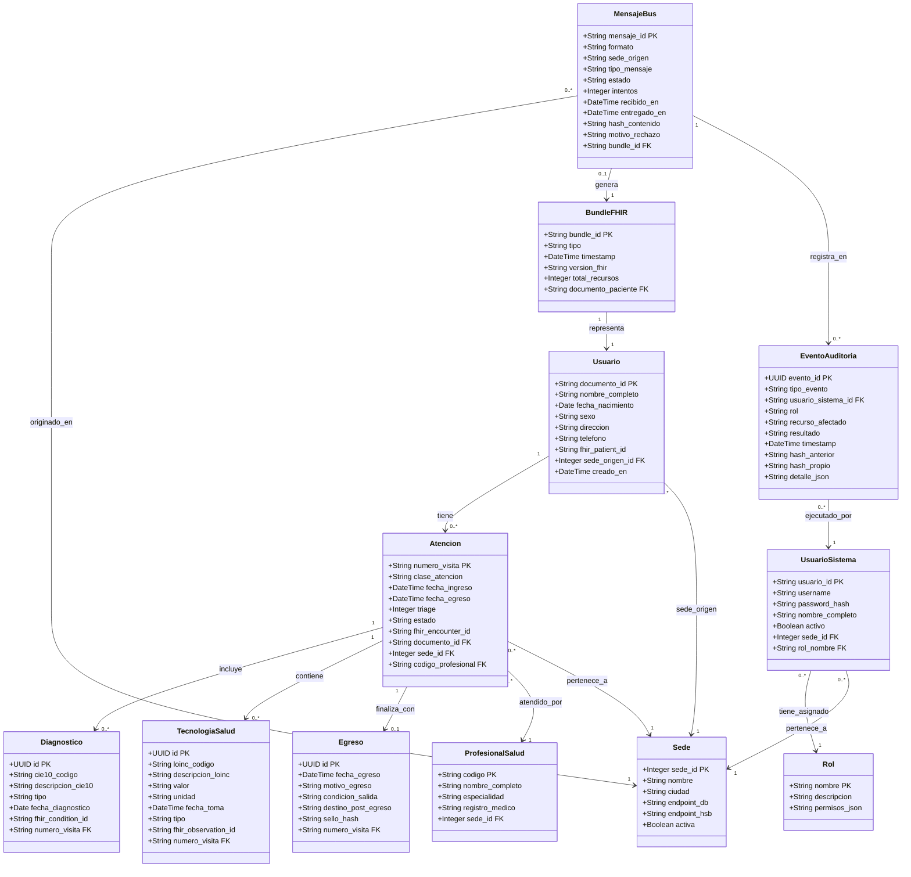

# Diagrama 3 · Clases del Dominio

**Responsable:** A — Jose Guillermo Canchila
**Herramienta:** Mermaid `classDiagram`

## Descripción

Muestra las 12 entidades principales del dominio: las 6 tablas clínicas (usuario, atención, diagnóstico, tecnología en salud, egreso, profesional), más las entidades de infraestructura (mensaje del bus, evento de auditoría, sede, Bundle FHIR, usuario del sistema, rol).

> **Supuesto de diseño:** `Usuario` es el paciente en el sistema clínico. `UsuarioSistema` es quien inicia sesión (puede ser médico, admisionista, etc.). Separamos ambos porque un médico nunca es el sujeto de una atención.

## Diagrama

## Notas de diseño

| Decisión | Razón |
|----------|-------|
| `fhir_patient_id` en `Usuario` nullable | Inicia nulo (cobertura FHIR 0 %). Se actualiza cuando el bundle se entrega a HAPI. |
| `hash_anterior` + `hash_propio` en `EventoAuditoria` | Implementa la cadena de auditoría (RF5). Detecta alteración sin Blockchain. |
| `estado` en `MensajeBus` | Refleja exactamente los estados del diagrama de estados (coherencia). |
| `permisos_json` en `Rol` | Flexible para agregar permisos sin migración de esquema. |
| `sello_hash` en `Egreso` | El médico recibe un sello al registrar el egreso (RF6 — vista médico). |

