# Diagrama 3 · Clases del dominio

**Responsables:** A — Jose Guillermo Canchila (diagrama) · B — Sharit Javier Manjarrez (revisión v2)
**Herramienta:** Mermaid `classDiagram`
**Versión:** v2 — 57 campos, traductor universal y repositorios para PostgreSQL y MongoDB

## Qué muestra

Tres grupos de clases, todas con su contraparte en el código:

1. **Dominio clínico (57 campos de la Res. 866 de 2021):** `Usuario`, `Atencion`, `Diagnostico`,
   `TecnologiaSalud`, `Egreso`, `ProfesionalSalud`, `Sede`. En PostgreSQL son tablas
   (`db/schema.sql`); en MongoDB son el documento `pacientes` con las atenciones embebidas
   (`db/sede2/init-mongo.js`). Los atributos se muestran con el nombre canónico (el de PostgreSQL);
   el número de campo de cada atributo está en [`docs/mapeo_57_campos.md`](../../mapeo_57_campos.md).
2. **Traductor:** `Campo` (una fila del catálogo `traductor/catalogo_57.py`) y `RegistroCanonico`
   (el pivote por el que pasa todo: HL7 / CSV / JSON → canónico → filas, documento o Bundle).
3. **Infraestructura:** `MensajeBus`, `EventoAuditoria`, `UsuarioSistema` y la jerarquía
   `RepositorioSede` ← `RepositorioPostgres` / `RepositorioMongo` (`db/repositorio.py`).

> **Supuesto de diseño:** `Usuario` es el paciente (así lo llama la Res. 866). Quien inicia sesión
> es `UsuarioSistema`. Un médico nunca es el sujeto de una atención.

## Diagrama

```mermaid
classDiagram
    direction TB

    class Sede {
        +Integer sede_id
        +String nombre
        +String ciudad
        +String codigo_prestador
        +String motor
        +Boolean activa
    }

    class Usuario {
        +String documento_id
        +String tipo_documento
        +String pais_nacionalidad
        +String nombre_completo
        +Date fecha_nacimiento
        +Integer edad
        +String unidad_edad
        +String sexo
        +String genero
        +String ocupacion
        +Boolean voluntad_anticipada
        +String categoria_discapacidad
        +String pais_residencia
        +String municipio_residencia
        +String etnia
        +String zona_residencia
        +String direccion_residencia
        +String telefono
        +String correo_electronico
        +String nombre_responsable
        +String parentesco_responsable
        +String telefono_responsable
        +String fhir_patient_id
        +Integer sede_origen_id
    }

    class Atencion {
        +String numero_visita
        +String entidad_salud
        +DateTime fecha_ingreso
        +String modalidad_entrega
        +String entorno_atencion
        +String via_ingreso
        +String causa_atencion
        +DateTime fecha_triage
        +String clasificacion_triage
        +String comunidad_etnica
        +String clase_atencion
        +String estado
        +String fhir_encounter_id
    }

    class Diagnostico {
        +String diagnostico_id
        +String cie10_codigo
        +String descripcion_cie10
        +String rol
        +String tipo_diagnostico
        +Integer orden
        +Date fecha_diagnostico
    }

    class TecnologiaSalud {
        +String tecnologia_id
        +String tipo
        +String descripcion_medicamento
        +String dosis
        +String via_administracion
        +String frecuencia
        +Integer dias_tratamiento
        +Integer unidades_aplicadas
        +String id_personal_salud
        +String finalidad_tecnologia
        +String loinc_codigo
        +Decimal valor
        +String unidad
    }

    class Egreso {
        +DateTime fecha_salida
        +String condicion_salida
        +String diagnostico_muerte
        +String codigo_prestador
        +String tipo_incapacidad
        +Integer dias_incapacidad
        +Integer dias_lic_maternidad
        +String alergias
        +String antecedentes_familiares
        +String riesgos_ocupacionales
        +String responsable_egreso
        +String sello_hash
    }

    class ProfesionalSalud {
        +String codigo
        +String nombre_completo
        +String especialidad
        +String registro_medico
    }

    class Campo {
        +Integer num
        +String clave
        +String nombre
        +String contenedor
        +Boolean obligatorio
        +String dominio
        +String hl7
        +String csv
        +String pg
        +String mongo
        +String fhir
        +String rol_dx
        +Boolean derivado
    }

    class RegistroCanonico {
        +Usuario usuario
        +Atencion atencion
        +List~TecnologiaSalud~ tecnologias
        +List~Diagnostico~ diagnosticos
        +Egreso egreso
        +desde_hl7(raw) RegistroCanonico
        +desde_fila_csv(fila, sede) RegistroCanonico
        +desde_json(obj, sede) RegistroCanonico
        +a_postgres() filas
        +a_mongo(existente) documento
        +bundle_desde_registro() Bundle
        +cobertura_57() cobertura
    }

    class RepositorioSede {
        <<abstract>>
        +Integer sede_id
        +String motor
        +ping() Boolean
        +guardar(registro) void
        +historia(documento_id) historia
        +cobertura_fhir() conteo
        +buscar_mensaje(mensaje_id, hash) MensajeBus
        +registrar_mensaje(mensaje) void
        +listar_mensajes(limite, estado) lista
    }

    class RepositorioPostgres {
        +String motor
        +guardar(registro) void
    }

    class RepositorioMongo {
        +String motor
        +guardar(registro) void
    }

    class MensajeBus {
        +String mensaje_id
        +String formato
        +Integer sede_origen
        +String tipo_mensaje
        +String estado
        +Integer intentos
        +String hash_contenido
        +String motivo_rechazo
        +String bundle_id
        +String contenido
        +DateTime recibido_en
        +DateTime entregado_en
    }

    class EventoAuditoria {
        +UUID evento_id
        +Integer indice
        +String tipo_evento
        +String usuario_sistema
        +String rol
        +String recurso_afectado
        +String resultado
        +String timestamp
        +String detalle
        +String hash_anterior
        +String hash_propio
        +verificar_cadena() resultado
    }

    class UsuarioSistema {
        +String username
        +String rol
        +String nombre_completo
        +String documento_id
        +Integer sede_id
    }

    %% Dominio clínico
    Usuario "1" --> "0..*" Atencion : tiene
    Atencion "1" *-- "0..*" Diagnostico : incluye
    Atencion "1" *-- "0..*" TecnologiaSalud : contiene
    Atencion "1" *-- "0..1" Egreso : finaliza_con
    Atencion "0..*" --> "0..1" ProfesionalSalud : atendida_por
    Atencion "0..*" --> "1" Sede : registrada_en
    Usuario "0..*" --> "1" Sede : sede_origen

    %% Traductor
    Campo "57" --o "1" RegistroCanonico : define_estructura
    RegistroCanonico ..> Usuario : traduce
    RegistroCanonico ..> Atencion : traduce

    %% Repositorios: misma interfaz, motor distinto
    RepositorioSede <|-- RepositorioPostgres
    RepositorioSede <|-- RepositorioMongo
    RepositorioSede "1" --> "1" Sede : representa
    RepositorioSede ..> RegistroCanonico : guarda y devuelve
    RepositorioSede "1" --> "0..*" MensajeBus : persiste

    %% Bus y auditoría
    MensajeBus "0..*" --> "1" Sede : originado_en
    MensajeBus ..> RegistroCanonico : se_traduce_a
    EventoAuditoria "0..*" --> "1" UsuarioSistema : ejecutado_por
    EventoAuditoria "1" --> "0..1" EventoAuditoria : hash_anterior
    Egreso ..> EventoAuditoria : sello_hash
```

## Notas de diseño

| Decisión | Razón |
|---|---|
| `RepositorioSede` abstracto con dos implementaciones | El HSB, la consulta unificada y el tablero piden `obtener_repositorio(sede_id)` y no saben qué motor hay detrás. Agregar una sede con otro motor es agregar una clase, no tocar el bus. |
| `Campo` como dato, no como código | Las 5 representaciones (HL7, CSV, PostgreSQL, MongoDB, FHIR) de cada campo están en una sola fila del catálogo. Si cambia el catálogo, cambian todas las traducciones. |
| `RegistroCanonico` como pivote | Con N formatos de entrada y M destinos se escriben N + M traducciones y no N × M. |
| Diagnósticos 33–39 como filas con `rol` | La resolución trae "diagnóstico de ingreso", "de egreso" y "relacionado 1 a 3" como columnas; guardarlos como filas con `rol` (INGRESO / EGRESO / RELACIONADO) y `orden` evita columnas vacías y produce un `Condition` por fila. El traductor los reconstruye. |
| `edad`, `unidad_edad`, `codigo_prestador` derivados | La sede no siempre los envía: se calculan de la fecha de nacimiento y del código REPS de la sede. |
| `fhir_patient_id` nulo al inicio | La cobertura FHIR por sede arranca en 0 % y sube cuando el Bundle del paciente se entrega a HAPI. |
| `hash_anterior` / `hash_propio` en `EventoAuditoria` | Cadena SHA-256 sobre (hash_anterior, índice, timestamp, usuario, rol, tipo, recurso, resultado, detalle). |
| `sello_hash` en `Egreso` | Es el `hash_propio` del evento `ESCRITURA_HC` que registró el egreso. |
| `estado` en `MensajeBus` | Toma los 7 valores del diagrama de estados. |

En MongoDB la composición `Atencion *-- Diagnostico / TecnologiaSalud / Egreso` es literal: los
diagnósticos, las tecnologías y el egreso son subdocumentos dentro de la atención, y la atención
es un elemento del arreglo `atenciones` del documento del paciente.
