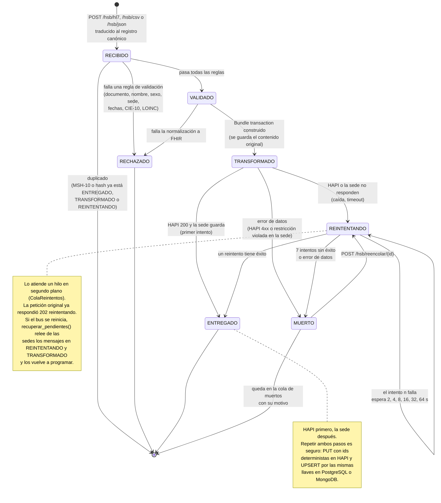

# Diagrama 4 · Estados del mensaje en el bus

**Responsables:** A — Jose Guillermo Canchila (diagrama) · B — Sharit Javier Manjarrez (revisión v2)
**Herramienta:** Mermaid `stateDiagram-v2`
**Versión:** v2 — cola persistente con trabajador en segundo plano, errores de datos y reencolado

## Qué muestra

El ciclo de vida de un `MensajeBus` (un mensaje HL7, una fila de CSV o un registro JSON de una
vista) con los 7 estados que pide la guía: **RECIBIDO, VALIDADO, TRANSFORMADO, ENTREGADO,
RECHAZADO, REINTENTANDO y MUERTO**. El estado se guarda en `mensaje_bus` de la sede del mensaje
(tabla en PostgreSQL, colección `mensajes_bus` en MongoDB), con `MSH-10` o el hash de la fila
como llave. Por eso sobrevive a un reinicio del bus.

"Duplicado" **no es un estado**: es la respuesta del bus cuando el mensaje ya existe; no se crea
ni se modifica nada.

## Diagrama

## Tabla de transiciones

| Desde | Hacia | Disparador | Dónde en el código |
|---|---|---|---|
| — | RECIBIDO | Llega el mensaje y el traductor lo convierte al registro canónico | `hsb/main.py`, `traductor.desde_hl7 / desde_fila_csv / desde_json` |
| RECIBIDO | (respuesta `duplicado`) | `mensaje_id` o `hash_contenido` ya existe en ENTREGADO, TRANSFORMADO o REINTENTANDO | `ingesta.procesar` → `verificar_idempotencia` |
| RECIBIDO | RECHAZADO | Al menos una regla de `validator.py` falla; se guardan todos los motivos | `validar_mensaje_pre_transformacion` |
| RECIBIDO | VALIDADO | Todas las reglas pasan | `ingesta.procesar` |
| VALIDADO | RECHAZADO | El normalizador lanza una excepción al construir algún recurso (motivo "Fallo al normalizar a FHIR R4") | `bundle_desde_registro` |
| VALIDADO | TRANSFORMADO | Bundle construido | `procesar_entrega_con_reintentos` |
| TRANSFORMADO | ENTREGADO | HAPI responde 200/201 y el repositorio de la sede guarda | `intentar_entrega` |
| TRANSFORMADO | REINTENTANDO | HAPI caído / timeout, o la sede no responde (`OperationalError`, `ServerSelectionTimeoutError`) | `procesar_entrega_con_reintentos` |
| TRANSFORMADO / REINTENTANDO | MUERTO | Error de datos: HAPI 4xx o `IntegrityError`, `DataError`, `CheckViolation`, `WriteError`… (motivo marcado `[permanente]`) | `ERRORES_DE_DATOS`, `PERMANENTE` |
| REINTENTANDO | REINTENTANDO | Falla el intento n < 7; espera `HSB_RETRY_BASE_SECONDS × 2^(n-1)` | `_reintentar`, `_espera` |
| REINTENTANDO | ENTREGADO | Un reintento tiene éxito | `_reintentar` |
| REINTENTANDO | MUERTO | Se completan `HSB_MAX_RETRIES` = 7 intentos | `_reintentar` |
| MUERTO | REINTENTANDO | Operador llama `POST /hsb/reencolar/{id}`; se vuelve a traducir el contenido guardado | `reencolar_mensaje` |

Valores por defecto en `docker-compose.yml`: `HSB_MAX_RETRIES=7`, `HSB_RETRY_BASE_SECONDS=2`. Entre
el primer intento y el séptimo pasan 2 + 4 + 8 + 16 + 32 + 64 = 126 s, tiempo suficiente para que
HAPI vuelva tras `docker compose start hapi-fhir` (tarda más de un minuto en responder).

Notas de implementación:

- **RECIBIDO** es el estado de entrada (cuenta en `/metrics` como recibido); la primera fila que
  se escribe en `mensaje_bus` es VALIDADO o RECHAZADO. Un mensaje con sede inválida se registra
  como RECHAZADO en el nodo de la sede 1 con `sede_origen = 0`.
- Si la sede de un mensaje está caída cuando el bus intenta escribir su estado, el estado queda en
  memoria del bus y se persiste en cuanto la sede responde; mientras tanto aparece en
  `/hsb/mensajes` como no persistido.
- Un mensaje RECHAZADO o MUERTO que la sede reenvía no se trata como duplicado: se procesa de
  nuevo (útil si la sede corrigió el dato o si HAPI ya volvió).

## Coherencia con los otros diagramas

- Los 7 estados son los valores del atributo `estado` de la clase `MensajeBus` (diagrama 3) y de
  la columna `mensaje_bus.estado` en `db/schema.sql`.
- Cada transición aparece como un mensaje al participante `mensaje_bus` en la secuencia (diagrama 2).
- Los estados los produce el caso de uso UC15 (diagrama 1), que incluyen UC14 (sistema de sede)
  y las escrituras de las vistas (UC5, UC8, UC9, UC10).
