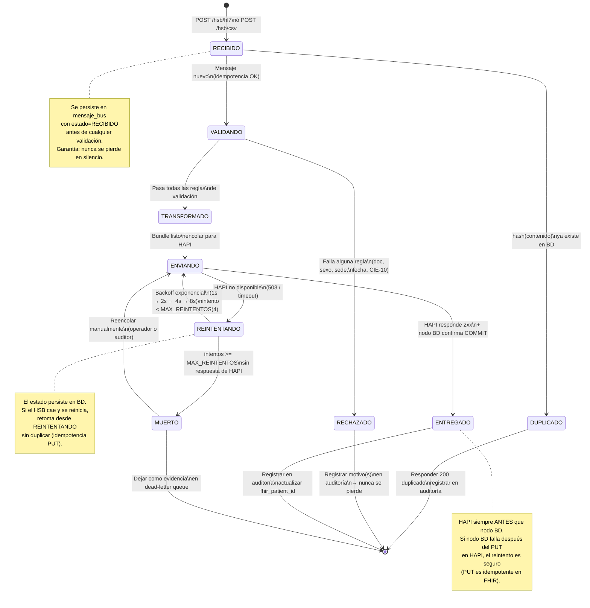

# Diagrama 4 · Estados del Mensaje en el Bus

**Responsable:** A — Jose Guillermo Canchila
**Herramienta:** Mermaid `stateDiagram-v2`

## Descripción

Muestra el ciclo de vida completo de un `MensajeBus` desde que entra al HSB hasta que es entregado, rechazado o muerto. Cada transición corresponde a una acción concreta del sistema y genera un `EventoAuditoria`.

## Diagrama

## Tabla de transiciones

| Desde | Hacia | Disparador | Evento de auditoría |
|-------|-------|-----------|---------------------|
| — | RECIBIDO | POST /hsb/hl7 ó /hsb/csv | `MENSAJE_RECIBIDO` |
| RECIBIDO | DUPLICADO | Hash ya existe en BD | `DUPLICADO_DETECTADO` |
| RECIBIDO | VALIDANDO | Hash nuevo registrado | — |
| VALIDANDO | RECHAZADO | Al menos 1 regla falla | `MENSAJE_RECHAZADO` |
| VALIDANDO | TRANSFORMADO | Todas las reglas pasan | — |
| TRANSFORMADO | ENVIANDO | Bundle FHIR generado y encolado | — |
| ENVIANDO | ENTREGADO | HAPI 2xx + BD COMMIT OK | `MENSAJE_ENTREGADO` |
| ENVIANDO | REINTENTANDO | HAPI 5xx / timeout | `REINTENTO` (con nº intento) |
| REINTENTANDO | ENVIANDO | Timer backoff cumplido, intento < 4 | — |
| REINTENTANDO | MUERTO | intentos ≥ 4 | `MENSAJE_MUERTO` |
| MUERTO | ENVIANDO | Reencolar manual | `MENSAJE_REENCOLADO` |

## Coherencia con otros diagramas

- Los estados `RECIBIDO`, `VALIDADO`, `TRANSFORMADO`, `ENTREGADO`, `RECHAZADO`, `REINTENTANDO`, `MUERTO` corresponden exactamente al campo `estado` de la clase `MensajeBus` (diagrama de clases).
- Las transiciones que generan `EventoAuditoria` corresponden a los participantes del diagrama de secuencia.
- Los actores que pueden reencolar un mensaje MUERTO son el **Auditor** (UC13 en casos de uso).

